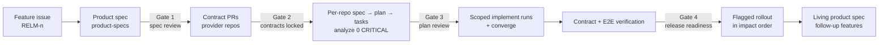

# Relm SDD Handbook

**How Relm builds and ships software as an AI-native company: spec-driven development with
GitHub Spec Kit, across many repositories, many teams, and one quality bar.**

Owner: `@spec-kit-relm/sdd-guild` · Applies to: every repository in `spec-kit-relm` ·
Status: **ratified v1.0** (2026-11-21)

> **The one-sentence version.** Every change starts as a spec that a human approved, crosses
> repository boundaries only through versioned contracts, is implemented by agents in small
> scoped runs, and merges only when automated gates and a human reviewer agree it matches the spec.

---

## Start here: reading order

| # | Read | Time | You will know |
|---|------|------|---------------|
| 1 | [Operating model](docs/01-operating-model.md) | 10 min | Teams, roles, the eight repositories, and what lives where |
| 2 | [The AI SDLC](docs/02-ai-sdlc.md) | 20 min | The seven phases, four gates, and who runs which Spec Kit command |
| 3 | [Work lanes](docs/03-work-lanes.md) | 5 min | When to use the full flow, a local spec, the bugfix lane, or no spec |
| 4 | [Rules](rules/README.md) | 15 min | Company, team and repository rules, and how they map to the constitution |
| 5 | [Playbook: cross-repo feature](playbooks/cross-repo-feature.md) | 20 min | Exact commands, step by step, using the worked example `RELM-1` |
| 6 | Your role's onboarding in [Onboard an engineer](playbooks/onboard-an-engineer.md) | 30 min | Local setup and your first task |

Then keep these at hand: [IDs, branches & traceability](docs/04-ids-branches-traceability.md),
[Contract-first](docs/05-contract-first.md), [Quality engineering](docs/06-quality-engineering.md),
[Constitution & governance](docs/07-constitution-and-governance.md),
[Agent instructions](docs/08-agent-instructions.md), [Spec lifecycle](docs/09-spec-lifecycle.md),
[Metrics](docs/10-metrics.md), [Pitfalls & FAQ](docs/11-pitfalls-faq.md), [Glossary](glossary.md).

## The organization at a glance

```text
spec-kit-relm/
├── .github              org profile, default issue/PR templates, workflow templates
├── sdd-handbook         ← you are here: process, rules, playbooks (humans read this)
├── speckit-platform     Spec Kit presets (= the rules), relm extension, CI gates (machines run this)
├── product-specs        product-level specs, impact maps, contract registry   (Spec Kit project, kind=product)
├── orders-service       Orders API — Java/Spring Boot                        (Spec Kit project, kind=backend)
├── inventory-service    Inventory API + events — Go                          (Spec Kit project, kind=backend)
├── web-storefront       customer web app — Next.js/TypeScript                (Spec Kit project, kind=frontend)
└── e2e-tests            cross-service E2E + scenario coverage — Playwright   (Spec Kit project, kind=qa)
```

## The flow at a glance



## Which document answers my question?

| Question | Go to |
|----------|-------|
| "Do I need a spec for this?" | [Work lanes](docs/03-work-lanes.md) |
| "Where does the spec for a cross-repo feature live?" | [Operating model → Where things live](docs/01-operating-model.md#where-things-live) |
| "What number/branch do I use?" | [IDs, branches & traceability](docs/04-ids-branches-traceability.md) |
| "I need to change an API another team uses" | [Playbook: contract change](playbooks/contract-change.md) |
| "The agent ignores our conventions" | [Agent instructions](docs/08-agent-instructions.md) |
| "I want to change a rule" | [Playbook: amend the constitution](playbooks/amend-the-constitution.md) |
| "We're adding a new service" | [Playbook: onboard a repository](playbooks/onboard-a-repository.md) |
| "What does QA do before code exists?" | [Quality engineering](docs/06-quality-engineering.md) |

## Official Spec Kit vs. Relm conventions

This handbook is explicit about the difference, because Spec Kit changes quickly:

- **Official Spec Kit (v1.4.3, pinned):** directory-scoped projects; the core commands
  (`constitution`, `specify`, `clarify`, `checklist`, `plan`, `tasks`, `analyze`, `implement`,
  `converge`); presets and extensions; the bundled `git` and `github`
  extensions; the [Contract-Driven Development guide](https://github.github.io/spec-kit/) for
  multi-repo products.
- **Relm conventions (this handbook + `speckit-platform`):** the `product-specs` hub repository,
  feature number = product issue number, the three-part constitution with synced read-only
  blocks, `impact.md` and `contracts.lock.md`, Phase R in every tasks file, the four gates, the PR
  evidence check, and the governance propagation bot.

## Contributing

Handbook changes go through a normal PR with label `lane:chore` (wording) or `lane:governance`
(anything that changes a rule). Rules themselves live in
the Relm presets in [`speckit-platform`](https://github.com/spec-kit-relm/speckit-platform/blob/main/governance/README.md)
— see [Amend the constitution](playbooks/amend-the-constitution.md).
