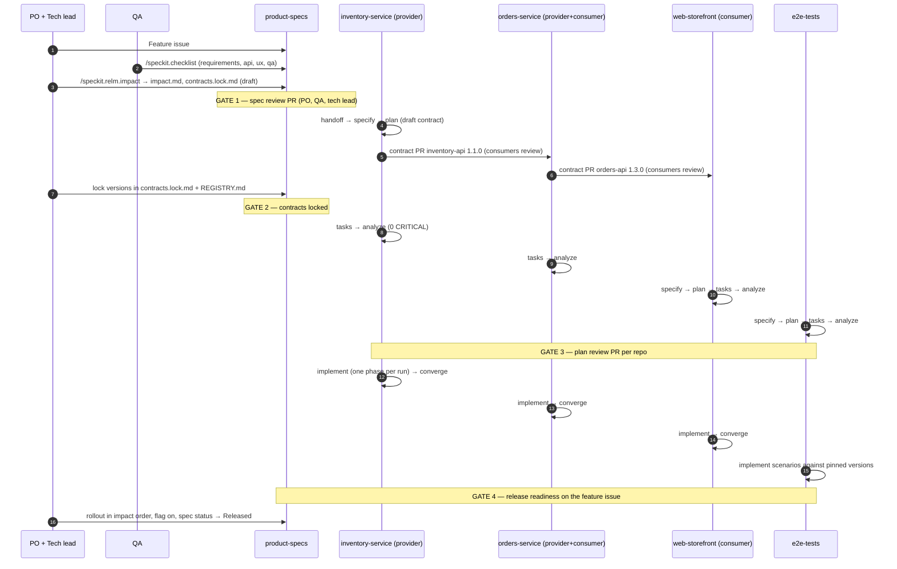

# 2. The Relm AI SDLC

Seven phases, four gates. Phases say **what happens**; gates say **what must be true to move on**.
Every gate is a pull request (or a checklist on the feature issue) with named approvers, so the
history of every decision is in Git.

---

## Phase 0 — Intake (PO, tech lead)

1. Open a **Feature** issue in `product-specs` using the *Product feature* form. Its number `n` is
   the Feature ID **`RELM-n`** for the rest of the feature's life
   ([IDs & traceability](04-ids-branches-traceability.md)).
2. Choose the lane ([Work lanes](03-work-lanes.md)). Only the **cross-repo** lane uses the full flow
   below.
3. Add the issue to the **Product Delivery** project with `Phase = Spec`.

## Phase 1 — Product specification (PO + QA spec partner, in `product-specs`)

| Step | Command | Output | Notes |
|------|---------|--------|-------|
| 1 | `/speckit.specify RELM-n <short-name>: <business intent>` | `specs/NNN-short-name/spec.md` on branch `NNN-short-name` | Relm wrapper passes `--number n`. WHAT/WHY only — no services, schemas or frameworks (PRD-2). |
| 2 | `/speckit.clarify` | answers recorded in `spec.md` → `## Clarifications` | Iterate until no `[NEEDS CLARIFICATION]` remains. QA reviews every answer. |
| 3 | `/speckit.checklist requirements`, `api`, `ux`, `qa` | `checklists/*.md` | Run by QA. "Unit tests for English": they test requirement quality. Never ticked by the agent. |
| 4 | `/speckit.relm.impact` | `impact.md`, draft `contracts.lock.md` | Tech lead validates repos, interface owners, slice sizes (≤ 5 dev-days), rollout/rollback order. |
| 5 | open PR `NNN-short-name` → `main` | | Set spec `**Status**: In Review`. |

### 🚦 Gate 1 — Spec review
*Approvers:* PO (stories, priorities, success criteria), QA (acceptance scenarios, checklists ticked
or explicitly accepted), tech lead (impact map).
*Automated:* `sdd-gates / spec-lint --kind product` (Feature ID, Given/When/Then, required files).
*On merge:* set `**Status**: Approved`; project `Phase = Contract`; assign a feature owner per repo
from `impact.md`.

## Phase 2 — Contract-first planning (provider feature owners, consumers review)

In every **provider** repository named in `impact.md`:

| Step | Command | Output |
|------|---------|--------|
| 1 | `/speckit.relm.handoff RELM-n` | Handoff brief: this repo's stories, scenario IDs, contracts to provide/consume |
| 2 | `/speckit.specify RELM-n <short-name>: <slice from the brief>` | `specs/NNN-short-name/spec.md` (same NNN in every repo) |
| 3 | `/speckit.clarify` | repo-level clarifications |
| 4 | `/speckit.plan` | `plan.md`, `research.md`, `data-model.md`, `quickstart.md`, `specs/NNN-*/contracts/*` (draft contract) |
| 5 | promote the draft to `contracts/<name>.yaml`, bump `info.version`, open a **contract PR** (label `contract-change`) | consumers are required reviewers (CODEOWNERS) |

The contract captures **semantics**, not only shapes: idempotency, retries, error/problem types,
ordering, timeouts ([Contract-first](05-contract-first.md)).

### 🚦 Gate 2 — Contracts locked
*Approvers:* every consumer feature owner + tech lead.
*Automated:* `contracts / contract-check` (lint, version bump, breaking-change detection).
*On merge:* provider tags `<contract>-v<version>`; tech lead updates `contracts.lock.md`
(status `locked`) and `contracts/REGISTRY.md` in `product-specs`; consumers vendor the locked
copy into `contracts/vendor/`. FE and BE can now work in parallel against generated mocks.

## Phase 3 — Repository planning (every feature owner)

| Step | Command | Notes |
|------|---------|-------|
| 1 | consumers: `handoff` → `specify` → `clarify` → `plan` | Plans reference only locked contract versions |
| 2 | `/speckit.tasks` | Relm wrapper: tests are mandatory, contract tests incl. negative cases, scenario IDs in test task names, flag task, small phases, **Phase R** last |
| 3 | `/speckit.analyze` | Read-only. Constitution MUST violations are CRITICAL. Fix spec/plan/tasks and re-run until **0 CRITICAL** |
| 4 | `/speckit.github.taskstoissues` | Creates dependency-ordered issues in *this* repo; link them as sub-issues of the feature issue and add to the project |
| 5 | open a **plan PR** (`plan.md`, `tasks.md`, artifacts) | Short review: architecture choices, contract versions, test tasks |

### 🚦 Gate 3 — Plan review (per repository)
*Approvers:* one peer from the same discipline; tech lead for new dependencies/ADRs (ORG-8).
*Automated:* `sdd-gates` on the PR.
*Tip:* merge the plan PR into `main` before implementing — implementation then happens in small
PRs per phase off the same `NNN-short-name` branch prefix (e.g. `NNN-short-name-us1`).

## Phase 4 — Implementation (feature owners, agent-assisted)

1. `/speckit.implement Phase 3` — **one phase per run** (the Relm wrapper enforces it). Long runs
   lose track of the plan around context compaction; small runs don't.
2. Review the diff like any human-written code; run the repo's test command (`AGENTS.md`).
3. Repeat per phase. Open one PR per phase or user story (`lane:feature`, `Feature: RELM-n`).
4. When all phases are done: `/speckit.converge`. It compares code to spec/plan/tasks and appends a
   `## Phase N: Convergence` section with remaining work. Loop *implement → converge* until it
   reports **Converged**.
5. `/speckit.relm.pr` assembles the PR description with evidence; `sdd-gates / pr-check` verifies it.

## Phase 5 — Verification (QA leads; starts in Phase 1, not after code)

- Given/When/Then scenarios from the product spec are the E2E test cases; IDs
  `RELM-n/USk/ASm` are in every test title.
- Providers run **provider verification** against their own contract; consumers run **consumer
  contract tests** against the pinned version. Mocks alone never prove the provider conforms.
- `e2e-tests` pins contract versions (`contracts.lock.json`) and selects expectations by version or
  capability flag, never by branch name.

### 🚦 Gate 4 — Release readiness (on the feature issue)
QA ticks, with links: all repos **Converged**, contract tests green, `@smoke` green in staging, all
P1 scenarios passing, dashboards for every success criterion exist (ORG-6), rollback rehearsed.

## Phase 6 — Release & rollout (tech lead)

Deploy in **interface dependency order** from `impact.md` (providers first, flags off), then enable
the flag progressively. Roll back in reverse: consumers' behavior off before providers roll back.
Record deployed versions against contract versions on the feature issue. Product spec
`**Status**: Released`; project `Phase = Released`.

## Phase 7 — Life after release

Product specs are **living**; repository specs are **flow-forward** ([Spec lifecycle](09-spec-lifecycle.md)).
A follow-up opens a new feature issue (`RELM-m`) that links to `RELM-n`. If shipped behavior differs
from the product spec, the PR that caused it also opens a `product-specs` PR (PRD-6).

---

## RACI per gate

| | Gate 1 Spec | Gate 2 Contracts | Gate 3 Plan | Gate 4 Release |
|---|---|---|---|---|
| PO | **A** | C | I | C |
| Tech lead | R | **A** | C | **A** |
| Feature owners | C | R | R | R |
| Consumers' owners | I | R (approve) | I | I |
| Peer reviewer | — | — | **A** | — |
| QA | R | C | C | R (sign-off) |

R = responsible, A = accountable/approver, C = consulted, I = informed.
