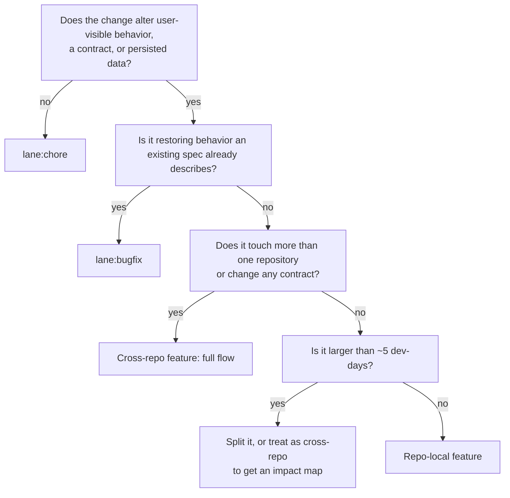

# 3. Work lanes — right-sizing the process

Full SDD is expensive in review time. Spec Kit works best on features a single developer can
complete in 1–5 days; applying the full flow to a typo fix turns one line into four user stories.
Every PR therefore declares exactly **one lane** (`sdd-gates / pr-check` enforces this, ORG-1).

| Lane | Label | Use when | Artifacts | Gates |
|------|-------|----------|-----------|-------|
| **Cross-repo feature** | `lane:feature` + `Feature: RELM-n` | Behavior spans ≥ 2 repositories, or any contract changes | Product spec + impact map in `product-specs`; slice spec/plan/tasks in each repo | 1, 2, 3, 4 |
| **Repo-local feature** | `lane:feature` + `Feature: RELM-n` | New user-visible behavior or data change inside one repository, no contract change | Feature issue in `product-specs` (for the number) but spec/plan/tasks only in the repo; central spec link = `n/a` | 3 (spec + plan in one PR), 4-lite (QA review) |
| **Bugfix** | `lane:bugfix` | Behavior deviates from an existing spec | Issue + failing regression test first; optionally Spec Kit's bundled `bug` extension (assess → fix → test) | Code review; QA for P1 areas |
| **Chore** | `lane:chore` | No behavior change: dependencies, refactoring, docs, build | PR description only | Code review |
| **Governance** | `lane:governance` | Constitution sync PRs, Part C amendments, AGENTS.md changes | PR description, Sync Impact Report | CODEOWNERS of `.specify/memory/` |

## Decision tree

## Rules of thumb

- **When in doubt between bugfix and feature:** if you need to *decide* new behavior, it is a
  feature. If the spec already says what should happen, it is a bug.
- **A bug in a contract** (the contract says one thing, both sides do another) is a contract change:
  cross-repo lane.
- **Spikes / prototypes** are `lane:chore` on a branch that is never merged; findings go into the
  `research.md` of the real feature.
- **Hotfixes** in production: bugfix lane, fix first, then the regression test may follow within
  24 hours with a linked issue — the only time a test may land after the fix.
